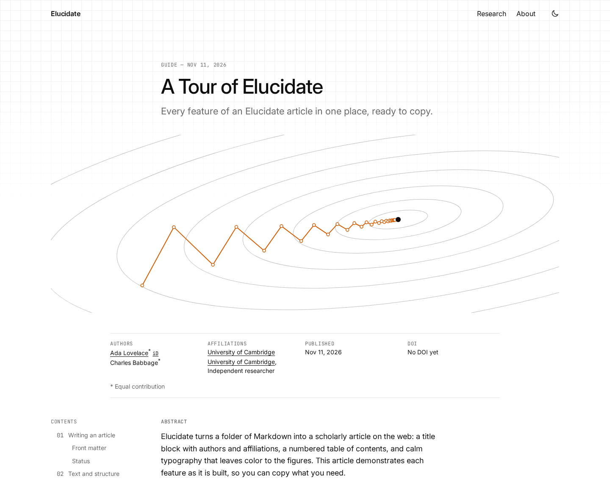

# Elucidate

Web-native scientific articles, in the spirit of Distill.

Write in Markdown, drop in interactive visualizations built with anything,
and publish a static site with the scholarly parts done for you:
authors and affiliations, numbered equations and figures, cross-references,
citations, footnotes, an appendix, and a "cite this" box.

<picture>
  <source media="(prefers-color-scheme: dark)" srcset="docs/images/article-dark.png">
  
</picture>

See it live: [elucidatejs.github.io/elucidate](https://elucidatejs.github.io/elucidate/).

## Start a publication

```sh
npm create elucidate@latest my-journal
cd my-journal
npm install
npm run dev
```

`npm create` asks for the title and the public URL; for GitHub Pages that is
`https://<user>.github.io/my-journal`. Open the address `npm run dev` prints, such as
http://localhost:4321/my-journal/. You'll see an example article that shows every feature.

## Write an article

```sh
npm run new -- "My first article"
```

Edit `src/articles/my-first-article/index.mdx`:

```mdx
---
title: "My first article"
description: "One sentence about it."
date: 2026-11-10
status: published
authors: [{ name: "Ada Lovelace" }]
---

Gradient descent [@nesterov2004] follows

$$ w^{k+1} = w^k - \alpha \nabla f(w^k) \label{eq:gd} $$

<Figure id="fig:demo" caption="Try it.">
  <MyWidget client:visible />
</Figure>

As @eq:gd and @fig:demo show, …
```

Citations come from `references.bib` next to the article, and components such as `MyWidget` from
`src/components/index.ts`. `npm run check` finds what a build would reject, with a fix for each.

## Publish

Push the site to a GitHub repository named after its folder, then
**Settings → Pages → Source: GitHub Actions**. Every push to `main` deploys.
Step by step: [docs/getting-started.md](docs/getting-started.md). Other hosts and custom domains:
[docs/deploying.md](docs/deploying.md).

## Learn more

- [Writing articles](docs/writing.md): math, figures, citations, footnotes, overlays
- [Components](docs/components.md)
- [Customizing](docs/customizing.md): settings, theme, your own components, overrides
- [Configuration reference](docs/configuration.md)
- [Design language](docs/design.md)
- [How it works](docs/architecture.md) · [Roadmap](docs/roadmap.md) · [Contributing](docs/contributing.md)

## License

Code: MIT. Example content: CC-BY-4.0.
