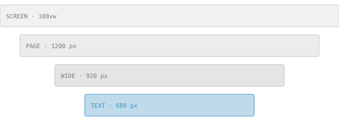

Elucidate is built for articles that explain something carefully. An article is a folder with an
`index.mdx` file, written in Markdown with components where you need them. Everything around the
text, from the byline to the table of contents, comes from the front matter.

## Writing an article

Each article lives in its own folder under `src/articles/`. The folder name becomes the URL, so this
article is at `/research/a-tour-of-elucidate/`. Put images, data and components for the article next
to it:

```text
src/articles/a-tour-of-elucidate/
├── index.mdx      the article
├── Hero.astro     the title visualization (optional)
└── figures/       images and data
```

### Front matter

The block at the top of `index.mdx` holds the article's metadata. Only `title`, `description`,
`date` and `authors` are required:

```yaml
title: "A Tour of Elucidate"
description: "One sentence, used in the index and in search results."
date: 2026-11-11
status: published   # draft | review | published
authors:
  - name: Ada Lovelace
    orcid: 0000-0002-1825-0097
    affiliations: [cam]
affiliations:
  cam: { name: University of Cambridge }
```

Mistakes are reported with the file, the field and the expected form, so a typo like `autors` tells
you that you probably meant `authors`.

### Status

A `draft` is visible only on your development server. An article in `review` is built at its URL
for reviewers but not listed or indexed by search engines. Only `published` articles appear in the
index.

## Text and structure

Sections start with `##` and subsections with `###`. They are numbered in the table of contents,
which floats beside the text on wide screens and folds into a "Contents" button on phones.

Body text is set at 18 px with generous line spacing, about 68 characters per line. Links are
underlined and use the text color, like [this link to the Distill journal](https://distill.pub).
Inline `code` sits on a light surface.

### Lists and quotes

- Bulleted lists for things without an order.
- Numbered lists for steps.
- Both can contain **strong** and *emphasized* text.

> Quotes are set with a hairline on the left and muted text, without a background.

### Tables

| Width    | Column      | Use                                  |
| -------- | ----------- | ------------------------------------ |
| `text`   | 680 px      | Body text, the default for figures   |
| `wide`   | 920 px      | Figures that need a little more room |
| `page`   | 1200 px     | Large figures and heroes             |
| `screen` | 100% of the window | Full-bleed visuals            |

### Code

Code blocks use a monospace font and grayscale highlighting: tone and weight instead of hue.

```ts
// Gradient descent on f(w) = ½ wᵀAw
function step(w: number[], grad: number[], alpha = 0.1): number[] {
  return w.map((wi, i) => wi - alpha * grad[i]);
}
```

## Images

Markdown images are optimized at build time. Alt text is required:



Content defaults to the text column. Wider figures can use the `wide`, `page` or `screen` widths
shown above.

## The hero

The visual under the title is `Hero.astro` from this article's folder. It can be any Astro
component: this one computes a gradient-descent path at build time and draws it as SVG, so it ships
no JavaScript. An image named `hero.png` (or `.svg`, `.jpg`, `.webp`, `.avif`) works too; give it
alt text with `hero: { alt: "…" }`.

Set `hero.width` to `wide`, `page` or `screen`, and `hero.position` to `above` to show the visual
before the title.
